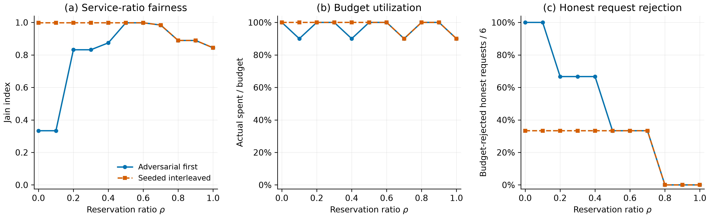

# Fairness Evaluation

Author: hehu

## 1. Evaluation Setup

We evaluate the frozen v1.1 semantics of `SpendPartition` using actual executions of `SpendPartition.pay()` in Foundry's local EVM. The experiment extends the existing `test/RhoSweep.t.sol` workload and reuses the deployment and agent helpers in `test/Base.t.sol`. The baseline repository commit is `f4f471653f93336979f85963222225be8767e283`, and the evaluation branch is `feat/hehu-fairness`. The contract source, frozen specifications, existing gas benchmarks, and compilation settings remain unchanged: Solidity 0.8.30, Prague EVM, optimizer enabled with 200 runs, and `via_ir = false`.

Each configuration has three registered delegates with equal reservation weights and equal priority, a window budget of 100, and requests of amount 10. Delegate A submits 10 requests, while B and C submit three each. Thus, the offered demands are `(100, 30, 30)`, totalling 160 across 16 requests. All monetary values in this section are integer token smallest units, as required by the specification; a budget of 100 does not mean 100 USDC. The helper prefunds each deployed `SpendPartition` with 6,400 units of `MockUSDC`, so liquidity does not constrain acceptance. All requests use registered callers, a valid recipient, and positive amounts. They are legitimate requests even when the budget rejects them.

A is labelled **aggressive** because it submits more requests and, in the adversarial scenario, submits first. B and C are labelled **honest**. These labels define the workload and the honest-request metric; they do not introduce different contract permissions, weights, or priorities.

We sweep `rho = k/10`, for `k = 0, ..., 10`, under two orderings:

- **`adversarial_first`:** `A A A A A A A A A A B B B C C C`.
- **`seeded_interleaved`:** `A C A A A B A B C A A A A B C A`.

The second ordering is generated from the first by descending Fisher–Yates with fixed seed `0x5eed` (decimal 24,301). Starting with `s = 24301`, for each `m = 16, 15, ..., 2`, the harness updates `s = (1664525*s + 1013904223) mod 2^32`, sets `j = s mod m`, and swaps positions `m-1` and `j`. This seed controls request ordering independently of Foundry's fuzz RNG. Each scenario reuses its identical sequence at every rho.

A fresh `SpendPartition` is deployed and separately prefunded for every `(scenario, rho)` pair. The harness reuses one `MockUSDC` token and merchant address across configurations, so the merchant balance and token total supply accumulate; transfer checks use per-call balance differences. All attempts remain within each SpendPartition's first seven-day window. The experiment therefore contains **22 SpendPartition deployments and 352 actual payment attempts**. These are deterministic configurations, not independent samples from a population of workloads.

The harness captures each call's outcome, complete revert data, reservations, effective spending, surplus usage, balance deltas, and a hash of relevant contract and token state. Only the exact `SpendPartition.SurplusExhausted` custom error, with the expected arguments, is classified as a budget rejection; unexpected reverts fail the experiment. After each attempt, assertions check aggregate spending against the budget, surplus usage against its cap, successful transfers, and rejection atomicity. The harness also checks acceptance when a request fits within the caller's remaining reservation under the stated authorization, liquidity, and standard-token assumptions.

## 2. Evaluation Metrics

Metrics follow [the frozen specification, section 6](frozen/Spec_v1.1_errata_2026-08-08.md). For each delegate `i`, `d_i` is its offered demand and `g_i` is the total amount actually granted by successful calls.

| Metric | Definition and applicability |
|---|---|
| Service ratio | `x_i = g_i / d_i`, for `d_i > 0`. |
| Jain fairness | `J = (sum_i x_i)^2 / (n * sum_i x_i^2)`, over the `n` positive-demand delegates. This measures equality of demand satisfaction. |
| Utilization | Total actual spending divided by the window budget, `sum_i g_i / 100`. |
| Stranded capacity | `100 - sum_i g_i`, applicable when aggregate demand is at least 100. |
| Overall budget rejection rate | Number of budget-rejected requests divided by all 16 legitimate requests. |
| Honest budget rejection rate | Budget-rejected B/C requests divided by their six legitimate requests, reported for either ordering. |
| Starvation rate | The honest budget rejection rate **under `adversarial_first` only**. It is `N/A` under `seeded_interleaved`. |

Jain is calculated over service ratios, not raw granted amounts. Equal grants can yield unequal service when demands differ. Zero-demand delegates are excluded from Jain, and a zero denominator, including an all-zero service vector, produces `N/A`. A missing honest-request denominator and stranded capacity when demand is below budget also produce `N/A`. The measured workload has positive demand for every delegate and aggregate demand 160, so its Jain, utilization, and stranded-capacity values are defined. The analysis uses exact rational arithmetic before exporting numeric metrics to 12 decimal places. Numerical fixtures in `analysis/test_fairness.py` are labelled unit tests and are separate from measured experiment data.

## 3. Measured Results

The observed calls are recorded in [fairness_trace.csv](../results/fairness_trace.csv), with 352 data rows. Aggregation produces [fairness_agents.csv](../results/fairness_agents.csv), with 66 delegate rows, and [fairness.csv](../results/fairness.csv), with 22 configuration rows. The adversarial delegate results also match all 33 rows of the existing `RhoSweep` output.

Table 1 includes every measured configuration. `H` is the number of honest budget-rejected requests out of six. In the adversarial columns, `H/6` is the starvation rate; in the interleaved columns it is an honest rejection diagnostic, while the CSV starvation field is `N/A`. Jain values below are rounded to six decimals; the linked CSV preserves 12 decimal places.

| rho | Adversarial Jain | Utilization | Stranded | H | Interleaved Jain | Utilization | Stranded | H |
|---:|---:|---:|---:|---:|---:|---:|---:|---:|
| 0.0 | 0.333333 | 100% | 0 | 6/6 | 0.997628 | 100% | 0 | 2/6 |
| 0.1 | 0.333333 | 90% | 10 | 6/6 | 0.997628 | 100% | 0 | 2/6 |
| 0.2 | 0.831615 | 100% | 0 | 4/6 | 0.997628 | 100% | 0 | 2/6 |
| 0.3 | 0.831615 | 100% | 0 | 4/6 | 0.997628 | 100% | 0 | 2/6 |
| 0.4 | 0.874155 | 90% | 10 | 4/6 | 0.997628 | 100% | 0 | 2/6 |
| 0.5 | 0.997628 | 100% | 0 | 2/6 | 0.997628 | 100% | 0 | 2/6 |
| 0.6 | 0.997628 | 100% | 0 | 2/6 | 0.997628 | 100% | 0 | 2/6 |
| 0.7 | 0.983740 | 90% | 10 | 2/6 | 0.983740 | 90% | 10 | 2/6 |
| 0.8 | 0.888889 | 100% | 0 | 0/6 | 0.888889 | 100% | 0 | 0/6 |
| 0.9 | 0.888889 | 100% | 0 | 0/6 | 0.888889 | 100% | 0 | 0/6 |
| 1.0 | 0.843700 | 90% | 10 | 0/6 | 0.843700 | 90% | 10 | 0/6 |

*Table 1. Service-ratio fairness, actual utilization, stranded smallest units, and honest request rejection for both deterministic orderings.*

At rho 0, adversarial ordering grants `(100, 0, 0)` to `(A, B, C)`: Jain is `1/3`, utilization is 100%, and all six honest requests are rejected. The same shared-pool configuration under the fixed interleaving grants `(60, 20, 20)`, with service ratios `(0.6, 2/3, 2/3)`, Jain `0.997627520759`, and two honest rejections. Thus, ordering alone changes who receives a fully consumed budget.

Under adversarial ordering, rho 0.5 and 0.6 also grant `(60, 20, 20)`, achieving the highest measured Jain together with 100% utilization. At rho 0.8 and 0.9, both scenarios grant `(40, 30, 30)`: every honest request succeeds, utilization is 100%, and Jain is `8/9` because service ratios are `(0.4, 1, 1)`. At rho 1, the static partition grants `(30, 30, 30)`, giving utilization 90% and Jain `0.843700159490`. Every 100%-utilization configuration accepts 10 requests and rejects six overall (`6/16 = 37.5%`); every 90%-utilization configuration accepts nine and rejects seven (`7/16 = 43.75%`).



*Figure 1. Actual local-EVM measurements for the two fixed orderings. Panel (a) plots Jain over delegate service ratios; panel (b) plots actual spending divided by the budget; panel (c) plots budget-rejected honest requests divided by six. Panel (c) is the specification's starvation metric only for the adversarial curve. Coincident curves overlap. The figure is exported as a 300-dpi [PNG](../results/fairness.png) and a vector [PDF](../results/fairness.pdf).*

## 4. Interpretation and Limitations

Reservation isolation reduces the aggressive delegate's ability to exhaust capacity protected for the other delegates. In this workload, adversarial starvation falls from 100% at rho 0 and 0.1 to zero at rho 0.8–1.0. This measured pattern does not establish a general monotonicity theorem: request sizes, apportionment, surplus competition, and ordering can change outcomes in other workloads.

Jain and utilization are non-monotonic across the measured rho values. Increasing rho first improves adversarial service-ratio equality. At rho 0.7, A's grant drops from 60 to 50 while B and C still receive 20 each, and Jain falls from `0.997627520759` to `0.983739837398`. At rho 0.8–0.9, B and C become fully served at 30 each while A receives 40; at rho 1, A receives 30. These allocations further reduce Jain because A receives a smaller fraction of its larger demand. Protecting honest access and maximizing equality of demand satisfaction are distinct objectives. The interleaved ordering already achieves Jain `0.997627520759` at rho 0, so reservations provide no further measured Jain improvement for this particular sequence. From rho 0.5 onward, the two scenarios have the same aggregate grant vectors and configuration-level metrics, except that starvation is defined only for the adversarial scenario. Their request orders and individual payment traces remain different.

The 10-unit request granularity explains why some configurations leave 10 units stranded despite aggregate demand exceeding the budget. For example, at rho 0.1 under adversarial ordering, reservations are `(4, 3, 3)` and the surplus cap is 90. After A spends 90, only four surplus units remain; B and C each need seven surplus units to complete a 10-unit request, so neither can pay. At rho 1, reservations are `(34, 33, 33)` and the surplus is zero. Each delegate pays 30, leaving `(4, 3, 3)` in isolated reservations. These residual units cannot fund another indivisible 10-unit request. This is capacity stranded by request granularity and isolation, not lost apportionment remainder: reservations still sum exactly to the reserved total.

The isolation guarantee applies to a request that fits entirely within the caller's remaining reservation, after local authorization and assuming sufficient liquidity and a successful underlying transfer. A request larger than that remainder needs contested surplus and may be rejected. Increasing reservations therefore does not guarantee that every legitimate request, or every request from an honest delegate, succeeds.

The results describe one three-delegate demand vector, one request size, one adversarial ordering, and one seeded interleaving in one window per deployment. There is no statistical sampling, confidence interval, or claim that this seed represents arbitrary transaction orderings. The experiment does not evaluate heterogeneous priorities, multiple windows, larger delegate sets, variable request amounts, nonstandard tokens, gas costs, or production network effects. It uses no real blockchain network, credentials, or private keys.

## 5. Reproducibility

The recorded reference environment uses Foundry **1.8.3** (build commit `cae51ad458f6abb64852b7709eb784352429825d`), analysis Python **3.12.14**, and matplotlib **3.11.2**. Dependency versions and protected-file/bytecode hashes are recorded in [environment.json](../results/fairness_audit/environment.json). The baseline audit used Python 3.14.3; the analysis and figures use the separate Python 3.12.14 environment. Install the analysis dependencies into an isolated environment with the pinned versions below. Run all commands from the repository root, on `feat/hehu-fairness`, with `forge` on `PATH`:

```sh
git submodule update --init --recursive
python3.12 -m venv .venv-fairness
source .venv-fairness/bin/activate
python -m pip install -r analysis/requirements-fairness.txt

forge --version
python --version
forge build
forge test

# Execute actual payments and overwrite the trace with the fixed-seed experiment.
forge test --match-contract '^FairnessTest$' -vv

# Validate the trace, regenerate both derived CSVs, and rebuild both figures.
python analysis/fairness.py

# Rebuild the PNG/PDF solely from the existing summary CSV.
python analysis/fairness.py --plot-only

# Synthetic metric-formula fixtures; these are unit tests, not experiment data.
python -m unittest discover -s analysis -p 'test_fairness.py' -v

# Run the actual harness and analysis twice, then compare all three CSVs.
python analysis/check_fairness_repro.py
```

The seed is a harness constant, so rerunning these commands reuses exactly `0x5eed` and the documented sequence. Each harness run overwrites the trace header before writing its 352 observations; results from prior runs are not appended. The reproduction checker compares `fairness_trace.csv`, `fairness_agents.csv`, and `fairness.csv` byte-for-byte between two fresh executions and records SHA-256 digests in [verification.json](../results/fairness_audit/verification.json). It also checks the existing `RhoSweep` measurements, protected source/configuration/specification/gas files, and the compiled creation bytecode and runtime bytecode template against the reference audit. This does not compare deployed runtime code after immutable values have been filled in. Run the full suite first so that `rho_sweep.csv` and compiled artifacts exist.

The protected artifact-hash checks use the saved baseline in `environment.json` and require the same reference compiler/toolchain and build configuration. Initialize all recursive submodules before building: Foundry autodetects remappings from nested dependency directories, and these remappings are part of compiler metadata. A different toolchain can change artifacts even when the source is unchanged; such a mismatch is reported as a failure and must be investigated rather than treated as experimental nondeterminism. CSV byte equality is the reproducibility criterion here; image-file byte equality is not asserted.

The final full suite passed **111 tests across 33 suites, with zero failures and zero skips**. The standalone fairness harness passed **one test**, and all **14 metric unit tests** passed. The same commands also passed in a fresh source snapshot with no pre-existing Foundry build output or cache, using the recorded toolchain and Python environment. The two-run check confirmed identical bytes for all three CSVs, 352 trace rows, 66 delegate rows, 22 configuration rows, agreement with all 33 existing `RhoSweep` rows, and unchanged protected files, compiled creation bytecode, and runtime bytecode template. The compact [final verification record](../results/fairness_audit/final-verification.json) lists the commands, outcomes, independent CSV/figure checks, and clean-build scope. Raw execution logs are local review artifacts and are excluded from this contribution.

These local checks support the fairness contribution; they do not replace Ruiqi's independent fresh-clone reproduction on the final integrated commit.
